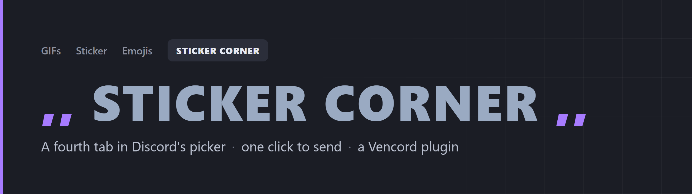
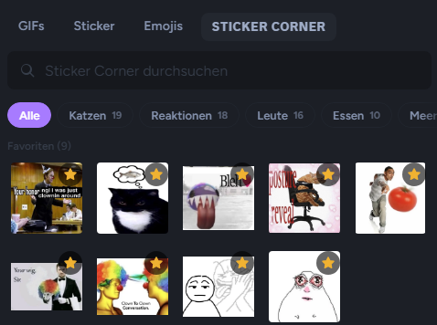
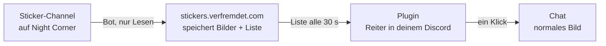

<p align="center">
  
</p>

<p align="center">
  <a href="README.md">English</a> · <b>Deutsch</b>
</p>

<p align="center">
  
  
  
  
</p>

<p align="center">
  <a href="#installieren"><b>Installieren</b></a> ·
  <a href="#was-du-bekommst">Funktionen</a> ·
  <a href="#worauf-das-plugin-zugreift">Worauf es zugreift</a> ·
  <a href="#aufbau">Aufbau</a> ·
  <a href="#fragen">Fragen</a>
</p>

---

**Sticker Corner** ist ein [Vencord](https://vencord.dev)-Plugin. Es fügt in Discords Auswahlfenster einen vierten Reiter ein, neben GIFs, Sticker und Emojis.
Ein Klick auf ein Bild, und es steht als normales Bild im Chat – alle sehen es, mit oder ohne Plugin, mit oder ohne Nitro.

Die Sticker sind die Bilder eines Channels auf dem Night-Corner-Server. Postest du dort ein Bild, haben es alle mit dem Plugin
nach spätestens 30 Sekunden. Löschst du es dort, verschwindet es aus dem Reiter.

<p align="center">
  
  <br>
  <sub>Der Reiter in Discords eigenem Fenster – Suche, Kategorien und oben deine Favoriten.</sub>
</p>

## Was du bekommst

### Senden

| | |
|---|---|
| **Ein Klick** | Sticker laden im Hintergrund hoch, während die Maus darauf liegt. Darum stehen sie sofort im Chat. |
| **Mit Sticker antworten** | Ein Knopf in der Leiste, die über jeder Nachricht erscheint. |
| **Meme-Text** | `Aa` am Sticker: Text draufschreiben, dann senden. |
| **Knopf in der Chat-Leiste** | Öffnet Sticker Corner direkt. |
| **Videos werden GIFs** | Kurze Videos aus dem Sticker-Channel werden automatisch umgewandelt. |

### Finden

| | |
|---|---|
| **Suche** | Nach Name und nach Kategorie. Tastatur: `↓` aus der Suche, Pfeiltasten zum Wählen, `Enter` sendet. |
| **Kategorien** | Katzen, Meer, Essen … werden am Namen erkannt. Eigene legt jeder mit `+` an. |
| **Favoriten, Zuletzt, Beliebt** | Stern drauf, was du magst. „Beliebt“ zeigt, was alle am meisten senden. Jeder Bereich lässt sich einklappen. |
| **✨ Passt gerade** | Eine Leiste über dem Eingabefeld schlägt Sticker und deine Discord-GIFs vor, die zum Chat passen. Sie lernt aus dem, was du sendest – auf deinem PC. |
| **⚔️ Auto-Konter** | Jemand sendet einen Sticker oder ein GIF, die Leiste schlägt vor, womit Leute genau darauf meistens antworten. |

### Spielen

| | |
|---|---|
| **🎰 Sticker-Slots** | Hebel ziehen, zufälligen Sticker gewinnen. Drei gleiche sind ein Jackpot. |
| **Deine Nr. 1** | Der Reiter zeigt deinen meistgesendeten Sticker und wie oft du jeden gesendet hast. |
| **Klänge** | Leise Klänge von [Kenney](https://kenney.nl) (CC0). In den Plugin-Einstellungen abschaltbar. |

### Eigene hinzufügen

| | |
|---|---|
| **Rechtsklick → Zu Sticker Corner hinzufügen** | Auf jedem Bild in Discord, wenn du in den Sticker-Channel posten darfst. |
| **Umbenennen und einsortieren** | Der Stift am Sticker ändert Name und Kategorien. |

<details>
<summary><b>Für das Night-Corner-Team: Ticket-Helfer</b></summary>

<br>

Das sehen nur Mitglieder mit den Team-Rollen, und nur in `ticket-…`-Kanälen.

| | |
|---|---|
| **Antwort-Vorschläge** | Eine Leiste über dem Eingabefeld. Gesendet wird erst per Klick. Schon gestellte Fragen verschwinden. |
| **Abstimmung** | Rein oder Raus, je Ticket. |
| **Team-Chat je Ticket** | Ein- und ausklappbar, eine rote Zahl zeigt neue Nachrichten. |
| **Ticket-Steckbrief** | Alter aus dem Geburtsdatum, Account-Alter, Beitrittsdatum, gemeinsame Server, ob die Regeln akzeptiert wurden. |
| **Ticket-Bingo** | 16 typische Ticket-Momente haken sich selbst ab. |
| **Bann-Knopf** | Nur nach einer Bestätigung. Nachrichten bleiben. |

</details>

## Installieren

Dauert 2–3 Minuten. Läuft in der Discord-App am Computer (nicht am Handy, nicht im Browser).

**Windows** – PowerShell öffnen und ausführen:

```powershell
irm https://raw.githubusercontent.com/verfremdet/sticker-corner/main/install.ps1 | iex
```

Oder dieses Repo herunterladen (**Code → Download ZIP**), entpacken und `install.cmd` doppelklicken.

**macOS / Linux:**

```bash
curl -fsSL https://raw.githubusercontent.com/verfremdet/sticker-corner/main/install.sh | bash
```

Danach Discord neu starten und das Stickerfenster öffnen.

<details>
<summary><b>Was der Installer Schritt für Schritt macht</b></summary>

<br>

Lies ihn, bevor du ihn ausführst: [`install.ps1`](install.ps1) · [`install.sh`](install.sh)

1. Prüft git, Node.js und pnpm. Unter Windows wird Fehlendes über `winget` installiert; ohne `winget` kommt es als einfaches ZIP von
   [git-for-windows](https://github.com/git-for-windows/git/releases) und [nodejs.org](https://nodejs.org) in den Sticker-Corner-Ordner.
   Unter macOS/Linux sagt das Skript, was fehlt.
2. Klont das offizielle [Vencord-Repo](https://github.com/Vendicated/Vencord) und dieses Repo.
3. Kopiert das Plugin in Vencord und baut es.
4. Patcht Discord mit Vencords eigenem Installer.
5. Schaltet das Plugin ein.

Er richtet keinen Autostart ein und lässt nichts im Hintergrund laufen. Alles liegt in `%LOCALAPPDATA%\StickerCorner`
(macOS/Linux: `~/.stickercorner`).

**macOS:** Sperrt das System Änderungen in `/Applications` („operation not permitted“), beendet das Skript Discord, patcht es auf dem
Schreibtisch und legt es zurück.

</details>

### Aktualisieren

Ein Hinweis im Reiter zeigt, wenn es eine neue Version gibt und was sich geändert hat. Ein Klick aktualisiert; wirksam wird es beim
nächsten Start von Discord. Den Installationsbefehl nochmal auszuführen macht dasselbe.

Vencord selbst aktualisierst du unter *Einstellungen → Vencord → Updater*.

### Entfernen

```powershell
irm https://raw.githubusercontent.com/verfremdet/sticker-corner/main/uninstall.ps1 | iex
```

macOS / Linux:

```bash
curl -fsSL https://raw.githubusercontent.com/verfremdet/sticker-corner/main/uninstall.sh | bash
```

Danach ist Discord wieder normal und der Sticker-Corner-Ordner gelöscht.

## Worauf das Plugin zugreift

Kurz: Es spricht mit einem Server und mit diesem Repo. Es liest weder deinen Token noch dein Passwort oder deine Nachrichten.
Jede Aussage unten verlinkt die Datei, in der du sie nachprüfen kannst.

| Was | Details | Nachprüfen in |
|---|---|---|
| **Netzwerk** | Nur `stickers.verfremdet.com` (Sticker-Liste und Bilder) und dieses Repo (Update-Prüfung). Beides steht fest im Code. | [`native.ts`](plugin/stickerCorner/native.ts), [`updater.ts`](plugin/stickerCorner/updater.ts) |
| **Senden** | Nur, wenn du einen Sticker anklickst. Es nutzt denselben Upload-Weg wie Discord, wenn du selbst ein Bild anhängst. | [`store.ts`](plugin/stickerCorner/store.ts) |
| **„Beliebt“** | Nach dem Senden nennt das Plugin dem Server die Nummer des Stickers, damit er mitzählen kann. Kein Name, kein Konto, kein Chat. | [`store.ts`](plugin/stickerCorner/store.ts) |
| **„Passt gerade“** | Was es aus deinen Chats lernt, bleibt auf deinem PC. Zusätzlich lädt es eine gemeinsame Liste: Der Bot liest die beiden Lobby-Kanäle und merkt sich, welches GIF nach welchen Worten kam – als verschlüsselte Wort-Kürzel (Hashes), nie als lesbarer Text. | [`suggest.ts`](plugin/stickerCorner/suggest.ts), [`brain.js`](server/src/brain.js) |
| **„Zu Sticker Corner hinzufügen“** | Nur sichtbar, wenn du sowieso in den Sticker-Channel posten darfst. Es lädt dieses eine Bild von Discords Servern und postet es unter dem eingegebenen Namen in den Sticker-Channel. | [`contextMenu.tsx`](plugin/stickerCorner/contextMenu.tsx) |
| **Ticket-Helfer** | Nur Team-Rollen. Stimmen und Team-Chat sind kurze Nachrichten im Team-Kanal `#ticket-votes`. | [`tickets/`](plugin/stickerCorner/tickets) |
| **Updates** | Der Update-Knopf holt dieses Repo per git und baut Vencord neu. Von anderswo wird nichts geladen. | [`native.ts`](plugin/stickerCorner/native.ts) |

## Aufbau



- [`plugin/stickerCorner/`](plugin/stickerCorner) – das Vencord-Plugin (TypeScript, React).
- [`server/`](server) – ein kleiner Node-Dienst. Ein Discord-Bot mit reinen Leserechten im Sticker-Channel speichert die Bilder und liefert sie aus.

## Fragen

**Brauchen andere das Plugin, um meine Sticker zu sehen?**
Nein. Ein gesendeter Sticker ist ein normales Bild.

**Brauche ich Nitro?**
Nein.

**Geht das am Handy oder im Browser?**
Nein, nur in der Discord-App am Computer.

**Welche Sprache nimmt es?**
Die von Discord: Deutsch, wenn Discord auf Deutsch steht, sonst Englisch. Umstellbar in den Plugin-Einstellungen.

**Sticker Corner ist nach einem Discord-Update weg.**
Discord ersetzt manchmal seine eigenen Dateien und entfernt dabei den Patch. Führe den Installationsbefehl nochmal aus.

**Ist das erlaubt?**
Discords Nutzungsbedingungen erlauben Client-Mods wie Vencord nicht. Laut Vencord wurde dafür bisher niemand gebannt. Entscheide selbst.

## Lizenz

GPL-3.0, wie Vencord. Klänge von [Kenney](https://kenney.nl), CC0.
