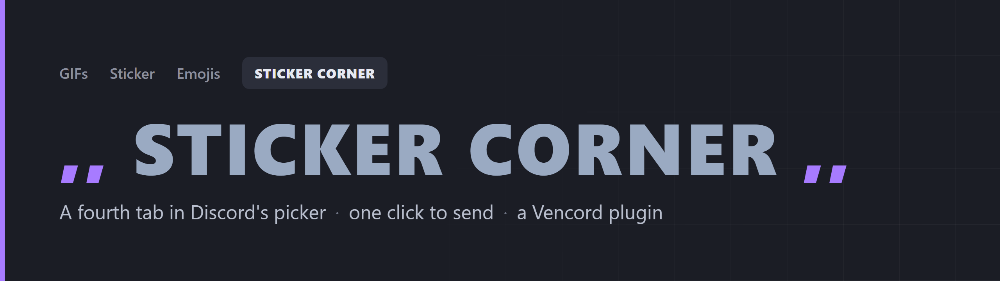
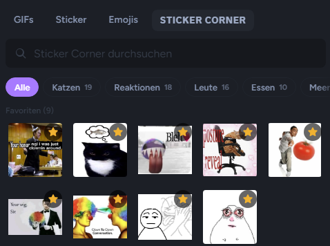
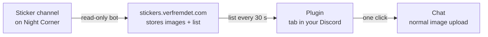

<p align="center">
  
</p>

<p align="center">
  <b>English</b> · <a href="README.de.md">Deutsch</a>
</p>

<p align="center">
  
  
  
  
</p>

<p align="center">
  <a href="#install"><b>Install</b></a> ·
  <a href="#what-you-get">Features</a> ·
  <a href="#what-the-plugin-accesses">What it accesses</a> ·
  <a href="#how-it-works">How it works</a> ·
  <a href="#questions">Questions</a>
</p>

---

**Sticker Corner** is a [Vencord](https://vencord.dev) plugin. It adds a fourth tab to Discord's picker, next to GIFs, Stickers and Emojis.
Click an image and it lands in the chat as a normal image upload – everyone sees it, with or without the plugin, with or without Nitro.

The stickers are the images of one channel on the Night Corner server. Post an image there and everyone with the plugin has it
within 30 seconds. Delete it there and it is gone from the tab.

<p align="center">
  
  <br>
  <sub>The tab inside Discord's own picker – search, categories and your favorites on top.</sub>
</p>

## What you get

### Send

| | |
|---|---|
| **One click** | Stickers upload in the background while your mouse rests on them, so they appear in the chat right away. |
| **Reply with a sticker** | A button in the hover bar of every message. |
| **Meme text** | `Aa` on a sticker: write text on it, then send. |
| **Button in the chat bar** | Opens Sticker Corner directly. |
| **Videos become GIFs** | Short videos from the sticker channel are converted automatically. |

### Find

| | |
|---|---|
| **Search** | By name and by category. Keyboard: `↓` from the search, arrows to move, `Enter` to send. |
| **Categories** | Cats, Sea, Food … recognized from the sticker name. Anyone can add their own with `+`. |
| **Favorites, Recent, Popular** | Star what you like. "Popular" shows what everyone sends most. Each section folds away. |
| **✨ Fits right now** | A bar above the message box suggests stickers and your Discord GIFs that match the chat. It learns from what you send – on your PC. |
| **⚔️ Auto counter** | Someone sends a sticker or GIF, the bar suggests what people usually answer to exactly that one. |

### Play

| | |
|---|---|
| **🎰 Sticker Slots** | Pull the lever, win a random sticker. Three of a kind is a jackpot. |
| **Your #1** | The tab shows your most-sent sticker and how often you sent each one. |
| **Sounds** | Quiet sounds by [Kenney](https://kenney.nl) (CC0). Switch them off in the plugin settings. |

### Add your own

| | |
|---|---|
| **Right-click → Add to Sticker Corner** | On any image in Discord, if you may post in the sticker channel. |
| **Rename and sort** | The pencil on a sticker edits name and categories. |

<details>
<summary><b>For the Night Corner team: ticket helper</b></summary>

<br>

Only members with the team roles see this, and only in `ticket-…` channels.

| | |
|---|---|
| **Suggested replies** | A bar above the message box. Nothing is sent until you click. Questions already asked disappear. |
| **Votes** | In or Out, per ticket. |
| **Team chat per ticket** | Folds in and out, a red number shows new messages. |
| **Ticket profile** | Age from the date of birth, account age, joined date, mutual servers, whether the rules were accepted. |
| **Ticket Bingo** | 16 typical ticket moments tick themselves. |
| **Ban button** | Only after a confirmation. Messages are kept. |

</details>

## Install

Takes 2–3 minutes. Works in the Discord desktop app (not mobile, not in the browser).

**Windows** – open PowerShell and run:

```powershell
irm https://raw.githubusercontent.com/verfremdet/sticker-corner/main/install.ps1 | iex
```

Or download this repository (**Code → Download ZIP**), extract it and double-click `install.cmd`.

**macOS / Linux:**

```bash
curl -fsSL https://raw.githubusercontent.com/verfremdet/sticker-corner/main/install.sh | bash
```

Then restart Discord and open the sticker picker.

<details>
<summary><b>What the installer does, step by step</b></summary>

<br>

Read it before you run it: [`install.ps1`](install.ps1) · [`install.sh`](install.sh)

1. Checks for git, Node.js and pnpm. On Windows, missing ones are installed with `winget`; without `winget` they are downloaded as plain
   ZIPs from [git-for-windows](https://github.com/git-for-windows/git/releases) and [nodejs.org](https://nodejs.org) into the Sticker Corner folder.
   On macOS/Linux the script tells you what is missing.
2. Clones the official [Vencord repository](https://github.com/Vendicated/Vencord) and this repository.
3. Copies the plugin into Vencord and builds it.
4. Patches Discord with Vencord's own installer.
5. Switches the plugin on.

It sets up no autostart and leaves no background process. Everything lives in `%LOCALAPPDATA%\StickerCorner`
(macOS/Linux: `~/.stickercorner`).

**macOS:** if the system blocks changes inside `/Applications` ("operation not permitted"), the script quits Discord, patches it on
your Desktop and moves it back.

</details>

### Update

A banner inside the tab tells you when there is a new version and what changed. One click updates; it takes effect the next time you
start Discord. Running the install command again does the same.

Vencord itself updates through *Settings → Vencord → Updater*.

### Uninstall

```powershell
irm https://raw.githubusercontent.com/verfremdet/sticker-corner/main/uninstall.ps1 | iex
```

macOS / Linux:

```bash
curl -fsSL https://raw.githubusercontent.com/verfremdet/sticker-corner/main/uninstall.sh | bash
```

Discord is back to normal afterwards and the Sticker Corner folder is deleted.

## What the plugin accesses

Short version: it talks to one server and to this repository. It does not read your token, your password or your messages.
Every claim below links to the file where you can check it.

| What | Details | Check it in |
|---|---|---|
| **Network** | Only `stickers.verfremdet.com` (sticker list and images) and this repository (update check). Both are fixed in the code. | [`native.ts`](plugin/stickerCorner/native.ts), [`updater.ts`](plugin/stickerCorner/updater.ts) |
| **Sending** | Only when you click a sticker. It uses the same upload path Discord uses when you attach an image yourself. | [`store.ts`](plugin/stickerCorner/store.ts) |
| **"Popular"** | After you send a sticker, the plugin tells the server that sticker's number so sends can be counted. No name, no account, no chat. | [`store.ts`](plugin/stickerCorner/store.ts) |
| **"Fits right now"** | What it learns from your chats stays on your PC. In addition it downloads a shared list: the bot reads the two lobby channels and remembers which GIF followed which words – as scrambled word codes (hashes), never as readable text. | [`suggest.ts`](plugin/stickerCorner/suggest.ts), [`brain.js`](server/src/brain.js) |
| **"Add to Sticker Corner"** | Only visible if you may post in the sticker channel anyway. It loads that one image from Discord's servers and posts it into the sticker channel under the name you typed. | [`contextMenu.tsx`](plugin/stickerCorner/contextMenu.tsx) |
| **Ticket helper** | Team roles only. Votes and team chat are short messages in the team-only channel `#ticket-votes`. | [`tickets/`](plugin/stickerCorner/tickets) |
| **Updates** | The update button pulls this repository with git and rebuilds Vencord. Nothing is downloaded from anywhere else. | [`native.ts`](plugin/stickerCorner/native.ts) |

## How it works



- [`plugin/stickerCorner/`](plugin/stickerCorner) – the Vencord plugin (TypeScript, React).
- [`server/`](server) – a small Node service. A Discord bot with read-only access to the sticker channel stores the images and serves them.

## Questions

**Do others need the plugin to see my stickers?**
No. A sent sticker is a normal image.

**Do I need Nitro?**
No.

**Does it work on my phone or in the browser?**
No, only in the Discord desktop app.

**Which language does it use?**
It follows Discord: German if Discord is set to German, English otherwise. You can change it in the plugin settings.

**Sticker Corner is gone after a Discord update.**
Discord sometimes replaces its own files and removes the patch with them. Run the install command again.

**Is this allowed?**
Discord's terms of service do not allow client modifications such as Vencord. Vencord states that no one has been banned for using it
so far. Decide for yourself.

## License

GPL-3.0, same as Vencord. Sounds by [Kenney](https://kenney.nl), CC0.
